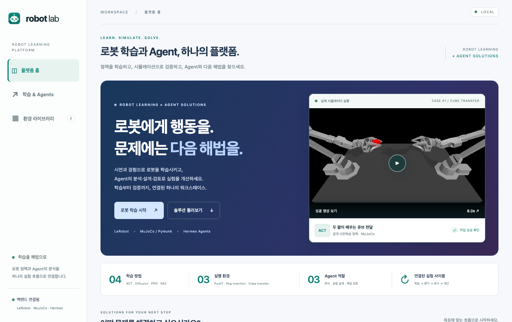
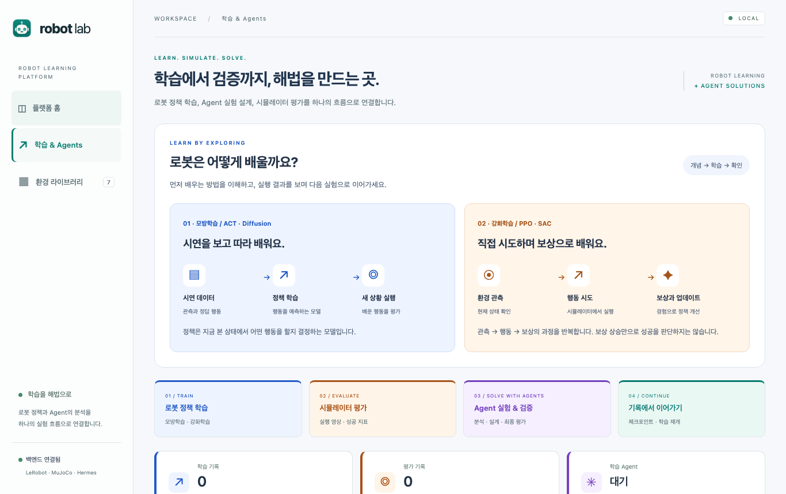
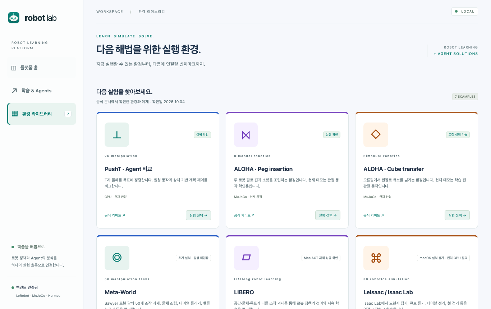

# rx-dev — Robot Lab · a robot-learning and agent-solutions platform
<p><a href="README.md" lang="ko">한국어</a> · <strong lang="en">English</strong></p>

A local platform that connects robot policy learning, simulator evaluation and agent-driven experiment improvement.
From the platform home you can move to the imitation/reinforcement-learning, agent experiment-design and
policy-verification solutions, and review real MuJoCo success cases and full evaluation results.
The learning workspace follows the flow train → evaluate → agent experiment → record and resume.
The analysis, design and review roles of the Hermes `rx-dev` profile read experimental evidence and compare
candidate configurations in the real simulator. No LLM is called for real-time control.

## Table of contents

- [Running](#running)
- [Screens](#screens)
- [Educational visualisation](#educational-visualisation)
- [Learning & Agents card workspace](#learning--agents-card-workspace)
- [Real LIBERO task success with a trained policy on macOS](#real-libero-task-success-with-a-trained-policy-on-macos)
- [LIBERO runtime verification on macOS](#libero-runtime-verification-on-macos)
- [Training and evaluating models with several methods](#training-and-evaluating-models-with-several-methods)
- [Hermes setup](#hermes-setup)
- [Agent scope and results](#agent-scope-and-results)
- [Role skills and controller improvement](#role-skills-and-controller-improvement)
- [Connecting model training to agents and skills](#connecting-model-training-to-agents-and-skills)
- [Candidate configuration comparison videos](#candidate-configuration-comparison-videos)
- [Verification](#verification)
- [License](#license)

## Running

```sh
sh run_app.sh
```

The frontend is at http://127.0.0.1:3030 and the backend at http://127.0.0.1:8787.
Install `uv` and `python3` first. `run_simulation.sh` prepares the Python 3.12 environment and the
LeRobot dependencies. The current run script uses macOS `/private/tmp`.
Local training and evaluation work without a Hermes connection.
In the dashboard, select a completed PushT record and press **Agent improvement experiment**.
The controller agent on the dashboard targets PushT. The model-training screen can also run
MuJoCo ALOHA training/evaluation and learning-agent experiments.

New run results, model weights, data caches and credentials are not included in the repository.
The two success videos, one failure video for comparison, and their source and measurement metadata
are included under `frontend/assets/success/`. These videos play without the backend or a local `outputs/`.
Past run IDs and result paths in the README are verification records from the development environment and
are not present in a fresh checkout. Records under `outputs/` are created when you run training and evaluation yourself.

## Screens

| | |
|---|---|
|  |  |
| Platform home — the bundled MuJoCo ALOHA cube-transfer success video and a summary of learning methods, environments and agent roles | Learning & Agents — concept diagrams for imitation/reinforcement learning and the train → evaluate → agent → resume flow (0 training records in a fresh clone) |
|  | |
| Environment library — PushT, ALOHA peg insertion / cube transfer, Meta-World, LIBERO and LeIsaac cards with their run status | |

The screenshots were taken without the LeRobot/MuJoCo virtual environment: only the backend
(`python3 -m backend.server`, standard library only) and the static frontend were running. There are no
training or evaluation records (`outputs/`), so the result cards are empty.

## Educational visualisation

Training (blue), evaluation (orange), agents (purple) and record/resume (teal) are distinguished by colour and title.
Concept diagrams explain the inputs and learning flow of imitation and reinforcement learning; choosing
ACT, Diffusion, PPO or SAC changes both the explanation and the actual training configuration. Selecting a
method alone does not start training. The UI explains what success rate, reward and 95% intervals mean, the
agent analysis/design/review roles, and the difference between development and final evaluation.
Educational examples are used only for explanation; result cards keep real measured values.

## Learning & Agents card workspace

Training configuration is split into policy/environment, learning signal/model and run-budget cards. The policy
evaluation card shows real success counts, success rates, best rewards and videos, and can expand a full
evaluation comparison table. The agent area consists of analysis/design/review role cards and a baseline-vs-candidate
comparison card; when a separate final evaluation exists, the measured success-rate interval and counterexamples are
shown too. Run records can be explored with kind filters, method/environment/ID search and "show more", and each
card shows checkpoints, logs and videos. `tests/browser_learning_cards.cjs` reads real records to verify displayed
values, playback persistence, search, filters and the mobile layout; form submissions are intercepted so that only
the submitted values are checked.

## Real LIBERO task success with a trained policy on macOS

Running the public ACT model `AmberHyunKIM/act_libero_goal_task0` at the pinned revision
`4db937e8de09123dd9b5707ab7704710000b5f25` on an Apple M4 Mac confirmed
**opening the middle drawer 3/3 times**. The three fixed initial conditions 0, 1 and 2 and
seeds 1000, 1001 and 1002 were used; first success came at steps 118, 113 and 125.
All runs kept LIBERO's native success verdict at the 300-step end.
This model is a public 100,000-step training checkpoint and was not trained further on this Mac.
This is a single-task case check and does not mean full LIBERO performance or transfer/continual learning was verified.

```sh
sh run_libero_success.sh --output outputs/libero-evaluations/drawer-new
```

The first run downloads about 207 MB of model and about 422 MB of simulator assets.
It uses the separate experimental virtual environment from `requirements/libero-act-macos.txt` and
does not modify the trained weights or optimizer. As in the model author's evaluation conditions,
`n_action_steps=10` is used, with the official LIBERO observation preprocessing and the model's
normalisation statistics applied on CPU.

The **"We opened the middle drawer"** area on the platform home shows all three videos and the results.
The LIBERO card in the environment library also links to this area.
`frontend/assets/success/libero-drawer/` contains the real videos (301 frames · 15.05 s each),
the raw action/success-verdict traces, and the hashes of model, video and traces plus the run versions.
Results were produced in `outputs/libero-evaluations/act-drawer-003/`; weights are excluded from the repository.
`tests/browser_libero_success.cjs` verifies real video playback, the full-result/raw-record links and the mobile layout
without a backend. The service can run ACT/Diffusion training, resume and evaluation plus agent comparison experiments
for both LIBERO tasks. Configuration and verification conditions are in the [LIBERO learning document](docs/libero-learning.md) (Korean).

### Putting the soup can in the basket

The public ACT model `rishi264/act-libero-alphabet-soup` at the pinned revision
`4008ed10261d06404d04c04490dc572da2430b7a` was run on the same Mac.
LIBERO-Object task 0 succeeded for initial states 0, 1 and 2 with seeds 1000, 1001 and 1002.
First success came at steps 144, 145 and 147, and all runs stayed successful until the 400-step end.
The public model was trained for 20,000 updates on 50 demonstrations and was evaluated here without further training.
Following the model author's input conditions, the 128×128 camera images are fed without flipping, with
`n_action_steps=1` and `temporal_ensemble_coeff=0.01`. Weights are loaded strictly.

```sh
sh run_libero_success.sh --policy basket --output outputs/libero-evaluations/basket-new
```

On the platform home, choose **Drawer manipulation / Object transfer** to watch the videos of both tasks.
`/?libero=basket#liberoSuccessShowcase` selects object transfer directly.
`frontend/assets/success/libero-basket/` contains three real videos (401 frames · 20.05 s each),
the final frames, the full action/verdict records and the hashes of model, assets and videos.
The original run results are in `outputs/libero-evaluations/act-basket-001/`.
This too is a result for three initial conditions of one task and does not generalise to other objects or the full benchmark.
`tests/browser_libero_basket.cjs` checks video playback, task switching, the raw verdicts and the mobile layout.

## LIBERO runtime verification on macOS

On an Apple M4 · macOS 26.7, initialisation of LIBERO-Spatial task 0, a 60-step run and camera-video saving were confirmed.
No trained policy was used and there was no task success.
The official LeRobot LIBERO extra is still Linux-only. In a separate experimental virtual environment the Linux EGL
device-probing packages `egl-probe` and `hf-egl-probe` were excluded and robosuite's macOS rendering path was used.
`requirements/libero-macos.txt` pins the packages that actually ran, and the `--no-deps` install is for this verification only.
It is not applied to the main training environment.

```sh
sh run_libero_probe.sh --steps 60
```

The first run downloads the pinned `lerobot/libero-assets` (about 422 MB).
Video, raw trace, versions and results are saved under `outputs/platform-probes/libero-macos/`.
The environment card in the service also shows the real run video from `frontend/assets/probes/libero/`.
This verification does not imply full task support or that LIBERO training/evaluation is wired into the service.

Resolution of the Isaac Sim 6.1.0.0 installation was also checked. There is no macOS ARM64 distribution, so it
cannot be installed, and running LeIsaac requires a connection to a supported GPU PC or server.
No GPU server address or access configuration was provided, so no remote run was performed.

## Training and evaluating models with several methods

### Running a pretrained policy that actually succeeds

The public model `lerobot/act_aloha_sim_transfer_cube_human` can be fetched and run on cube transfer in local MuJoCo.
It is a public 80,000-step training checkpoint and is separate from the briefly trained PPO model in this project.
See the model repository's description and raw material: https://huggingface.co/lerobot/act_aloha_sim_transfer_cube_human

```sh
HF_HOME="$PWD/outputs/hf-cache" TORCH_HOME="$PWD/outputs/torch-cache" \
  /private/tmp/rx-dev-lerobot-venv/bin/python -m lerobot.processor.migrate_policy_normalization \
  --pretrained-path lerobot/act_aloha_sim_transfer_cube_human \
  --revision ba73b2766f1371cdc133ca4efb97eb090d744625 \
  --output-dir outputs/pretrained/act_aloha_transfer_migrated

/private/tmp/rx-dev-lerobot-venv/bin/python -m backend.pretrained_success \
  --model outputs/pretrained/act_aloha_transfer_migrated \
  --output outputs/pretrained-transfer-NEW --full-rollout
```

LeRobot's official migration tool moves the normalisation statistics into the processor.
The model's trained weights are not retrained. `--full-rollout` keeps recording the real physics simulation
up to 400 steps after the first official success and records first and final success separately.
In the real run on 2026-10-05 the pre-chosen seeds 42000 and 42001 succeeded and 42002 failed.
The two successful runs reached reward 4 and stayed successful until the 400-step end.
The three videos and the full reward traces were preserved. Three initial conditions are not a generalisation benchmark.

Selecting the pretrained ACT record in the dashboard shows all run videos.
A `?report=<run ID>` link opens a specific record directly.
The **"Learned behaviour, in a real run"** area on the first dashboard screen plays and downloads the bundled
success videos. Expanding **Full evaluation results** shows the 2/3 success measurement table and the failure video.
`tests/browser_showcase.cjs` verifies playback, download, full results and the mobile layout with the backend connection blocked.

Choose the learning method and run mode from the **Learning & Agents** menu on the left.
Imitation learning uses the LeRobot 0.6.1 trainer; reinforcement learning uses Stable Baselines3 2.9.0 with
the gym-pusht and MuJoCo-based gym-aloha simulators.

| Method | Learning signal | Input | Meaning of a step |
| --- | --- | --- | --- |
| ACT | error between demonstrated and predicted actions | video + robot position | weight update |
| Diffusion Policy | diffusion/denoising error of demonstrated actions | video + robot position | weight update |
| PPO | environment reward from new experience | object/robot positions and angles | environment steps to collect |
| SAC | environment reward from the replay buffer | object/robot positions and angles | environment steps to collect |

ACT/Diffusion use the first N demonstration episodes of the default `lerobot/pusht` or another LeRobot-format Hub dataset.
The `compact` model size is for local experiments: ACT is reduced to hidden dimension 128, feedforward 512,
two encoder/VAE-encoder layers each and action chunk 16; Diffusion is reduced to U-Net channels 128/256/512,
horizon 16 and action execution length 8. `standard` uses each policy's official default architecture.
The two sizes are different models and the configuration is stored with the results.

PPO/SAC take no dataset and collect experience directly in the selected environment.
On PushT, `gym_pusht/PushT-v0` is used. The maximum episode length is 300 steps and the PushT reward is the
environment's original overlap reward. The MLP policy receives the four normalised position coordinates and the
sin/cos of the angle. Actions are mapped from [-1, 1] to the environment's [0, 512] target coordinates.
Because this method knows the object position directly, it is not a like-for-like comparison with video-input imitation learning.
PPO lets you set the rollout interval and batch size; PPO/SAC let you set the learning rate and discount factor.
PPO collection steps must be a multiple of the interval and the interval a multiple of the batch size.
SAC performs one update per step after the initial 32 steps, with a replay buffer of 100,000.

Run modes:

- **Train a new model**: trains a new policy with the chosen method.
- **Fine-tune a saved model**: loads ACT/Diffusion weights and architecture and trains with a new optimizer.
  The dataset can change, but the observation/action features must be compatible with the existing model.
- **Continue from a checkpoint**: ACT/Diffusion restore weights, optimizer, scheduler and step.
  The step input is the total target after resuming; the original dataset, episodes, batch and seed are kept.
  PPO/SAC load the policy and optimizer and add the entered number of environment steps.
  SAC also restores the saved replay buffer. Bit-exact reproduction, restoring the environment state and all
  random states, is not guaranteed. Configuration keeps the values of the original run.

The default device is CPU. MPS/CUDA can be chosen where that device is actually available.
Training, policy evaluation, the existing simulation and agent experiments do not run concurrently.
Configuration, logs and state are kept under `outputs/training/<id>/`; completed original records are not overwritten
when a run is stopped or the server restarts. On stop, work since the last save may be lost.

ACT/Diffusion weights and processor are stored under `model/checkpoints/<step>/pretrained_model/`, with the optimizer
and similar in that checkpoint's `training_state/`. PPO/SAC store `model/policy.zip`, and SAC its replay buffer in
`model/replay_buffer.pkl`. Training saves every 1,000 steps and at the last step. SAC's replay buffer is saved on
normal completion, so to continue after an intermediate stop you must choose a completed SAC record.

Training supports two tasks, PushT and MuJoCo ALOHA. All three environments connect to ACT/Diffusion/PPO/SAC
training, policy evaluation and agent learning experiments.

| Environment | Physics engine | ACT/Diffusion demonstration data |
| --- | --- | --- |
| PushT | Pymunk | `lerobot/pusht` |
| ALOHA · Peg insertion | MuJoCo | `lerobot/aloha_sim_insertion_scripted` |
| ALOHA · Cube transfer | MuJoCo | `lerobot/aloha_sim_transfer_cube_scripted` |

Selecting an environment changes the default demonstration data. Combinations of official data with a different task,
and resuming a checkpoint from a different environment, are rejected. The general training API accepts `pusht`,
`aloha` and `transfer` in `environment`. Evaluation and agent experiments keep the environment of the original record.
Existing PushT records work without an environment field.

ALOHA imitation learning uses the top camera and the 14-dimensional joint state.
ALOHA reinforcement learning uses privileged simulator state: joint and object poses and velocities.
Actions are joint-target changes of at most 0.08 rad per step and 0–1 targets for the two grippers.
MuJoCo's default 0–4 step reward is used as is, and success is the official `is_success` / reward 4.
Video models and state models are not treated as performing under the same input conditions.
Short training in a sparse-reward environment is a connectivity check and does not guarantee task success.
On macOS, MuJoCo rendering needs access to graphics services.

The MuJoCo connection verification actually trained eight policies — the four methods on peg insertion and cube
transfer — and confirmed a 10-step evaluation and video playback for each. ACT resume was confirmed in both environments.
PPO recorded 10 gradient updates over 128 environment steps and SAC 32 over 64 environment steps.
Results are in `outputs/mujoco-learning-verification.json`. All short evaluations had a success rate of 0 and must not
be read as a performance benchmark. Resuming saved PPO/SAC models was also confirmed in both environments: PPO reached
256 cumulative steps · 20 updates, SAC 128 cumulative steps · 96 updates.
The original and resumed record IDs are preserved in `outputs/mujoco-continuation-verification.json`.

Full MuJoCo–Hermes connection verification on 2026-10-05: experiment `30cf44aee71f4d9fbe9bf81ca02d559c` compared
peg-insertion PPO batch size 8 → 16. Both policies were trained for 128 environment steps with the same training seed
500001 and each evaluated for 10 steps on the new seed 40001. The analysis/design/review roles, applied skills, real
training/evaluation and desktop/mobile display all passed. Both policies scored 0/1 success · best reward 0, so the
real review verdict is `inconclusive`. Videos were saved as
`outputs/training/36f9988cbb37465caf470903b05b3b6e/evaluation/seed-40001.mp4` (baseline) and
`outputs/training/9c0a190ba3e9431891f5e0c66853d50c/evaluation/seed-40001.mp4` (candidate).

The **Evaluate policy** button on a training record runs the trained policy in the environment stored in the record.
ACT/Diffusion records trained on the official per-environment demonstration data below can be evaluated.
Choose the number of evaluation episodes (1–20), the step limit (10–300) and the compute device.
Runs start from seed 20000 under the same initial conditions and save the success rate, mean best reward, videos and raw
data under `evaluation/`. LeRobot evaluation records up to the first 10 episodes; PPO/SAC record all episodes.
Only compare results with the same inputs, seed, episode count and step limit.
If you tuned while reusing the evaluation conditions, an evaluation on separate initial conditions is needed before claiming final performance.

Dataset and video-encoder caches live in `outputs/hf-cache/` and `outputs/torch-cache/`.
Hub upload and W&B logging are disabled. Collecting your own demonstrations, VLA training and LeRobot HIL-SERL
human-in-the-loop RL are currently outside the UI's scope. Automatic conversion of existing MP4/trace JSON into
demonstration datasets does not exist yet either.

API:
`GET /api/training/methods`, `GET /api/training`, `GET /api/training/current`,
`POST /api/training`, `POST /api/training/evaluate`, `POST /api/training/stop` (`{}`).

```json
{"algorithm":"diffusion","mode":"new","preset":"compact","dataset":"lerobot/pusht","device":"cpu","steps":1000,"batch_size":8,"episodes":10,"seed":1000}
```

```json
{"algorithm":"ppo","mode":"new","device":"cpu","steps":1024,"batch_size":8,"rollout_steps":128,"learning_rate":0.0003,"gamma":0.99,"seed":1000}
```

```json
{"source_job":"32-character ID of a training record","device":"cpu","episodes":5,"step_limit":300}
```

Official references: [LeRobot training](https://huggingface.co/docs/lerobot/main/il_sim),
[PPO](https://stable-baselines3.readthedocs.io/en/master/modules/ppo.html),
[SAC](https://stable-baselines3.readthedocs.io/en/master/modules/sac.html).

The verification on 2026-10-04 confirmed 14 real runs in total: new training, resume, fine-tuning and evaluation for
ACT/Diffusion, and new training, continued training and evaluation for PPO/SAC.
For reinforcement learning it checked that real gradient updates occurred.
Raw data: `outputs/learning-validation-20261004/verification.json`.
This is a functional check, not a benchmark of training performance. To re-verify into a new directory:

```sh
/private/tmp/rx-dev-lerobot-venv/bin/python -m scripts.verify_training_methods --output outputs/learning-validation-NEW
```

## Hermes setup

The following mapping is installed on this Mac.

```text
frontend :3030 → backend :8787 → Hermes gateway :8700
                              → upstream rx-dev :8679 → Hermes Agent Engine
```

The shared gateway registers the upstream `rx-dev` and the model alias `rx-dev` → `rx-dev/rx-dev`.
Every run and query sets `X-Hermes-Upstream: rx-dev` explicitly.
Each role has its own session and a real Hermes run ID, so roles do not share conversation history.
The installed Hermes per-profile service structure is kept and other profiles are not modified.

For a fresh setup, run with **the Python of the installed Hermes virtual environment**.

```sh
"${HOME}/.hermes/hermes-agent/venv/bin/python" scripts/setup_hermes.py \
  --gateway-env /path/to/shared-gateway/.env \
  --source-profile default --start
```

The setup script creates a dedicated profile/API key and preserves the existing shared gateway paths, keys and default
routes. The previous configuration and `.env` are backed up in their original directory with mode 600.
`--start` includes restarting this Mac's launchd service and the shared gateway, so if another project is running a long
job, coordinate the restart time.

The key is stored only in `~/.hermes/profiles/rx-dev/.env` and is never sent to the browser.
The backend reads this file. If needed, override with the `RX_DEV_HERMES_ENV`,
`RX_DEV_GATEWAY_BASE_URL` and `RX_DEV_GATEWAY_KEY` environment variables.
Only local loopback gateway addresses are allowed.

## Agent scope and results

1. The analysis agent reviews the no-contact and stall segments computed from the full trace, the official success criterion and failure-state samples.
2. The design agent reads the past experiment history and changes exactly one setting within the allowed range. Candidates already evaluated are rejected.
3. The backend checks the configuration's keys, types and compute budget, then runs the existing configuration and the candidate on the same 10 new seeds.
4. A separate verification agent reviews the real measured results and their limitations.

Only one experiment runs at a time, and agents and the regular simulation do not run concurrently.
New seeds exclude those of existing evaluations, past agent experiments and the separate controller study.
A new experiment separates initial-condition seeds from exploration seeds and fixes the exploration RNG at 12345.
The 95% Wilson interval of the success rate is stored as well. A higher success count is labelled
`improved`, lower `regressed` and equal `inconclusive`.
This is the verdict of a single development experiment and guarantees neither statistical significance nor generalisation.
Candidates are not adopted automatically as the default controller and original results are not overwritten.

The agents' terminal, file and external-service tools are disabled. Numeric data and some state records are sent to
the model provider configured in Hermes; the original videos stay local.
There is currently no real-robot connection or deployment-approval feature.

`outputs/agents/<job-id>/` stores the input evidence, per-role output and run IDs, configuration requests, simulator
logs and paired evaluation results. A run can be stopped from the UI.
On a network query error the same run ID is re-queried and never re-run twice.
Agent responses rejected by output validation remain only in the job folder as `rejected_<role>.json` and are not exposed via the API.
Jobs interrupted by a backend restart are not re-run automatically; the stored run ID is kept.

## Role skills and controller improvement

The analysis, experiment-design and evaluation-review skills under `skills/` are included in each role's actual run
instructions. Design enforces single-variable changes, reuse of failure history and fresh evaluation conditions; review
only allows verdicts that match the backend's success counts. To update the installed copies:

```sh
python3 scripts/install_rx_dev_skills.py
```

This updates the three controller skills and three learning skills of the Codex skills and the dedicated Hermes rx-dev profile.
Free-form LLM narrative can still misread numbers, so the measurement tables and stored JSON take precedence.

## Connecting model training to agents and skills

**Start agent learning experiment** on the model-training screen uses a completed PushT or MuJoCo ALOHA training record as analysis evidence.
It runs `rx-dev-learning-analysis` → `rx-dev-learning-design` → local training/evaluation →
`rx-dev-learning-review`, and each role directly includes the corresponding `SKILL.md` from the repository.
They apply to role runs even without installing the skills. A Hermes model connection is required, and numeric learning
curves, configuration and evaluation metrics are sent to the connected model provider. Original videos and raw training logs are not sent.

The design agent changes only one of batch size, training steps or, for reinforcement learning, learning rate or discount
factor within the same algorithm. The backend checks ranges, PPO multiples and duplicate proposals.
The original checkpoint is not modified; both baseline and candidate are **trained from scratch** as small models,
with the same initialisation seed and new, identical evaluation seeds. Changing the training amount or batch size may also
change the compute cost, and an improvement in model performance is not guaranteed.

Per-policy limits are 1–512 updates for ACT/Diffusion, 128–2048 environment steps (multiples of 128) for PPO and 64–2048
environment steps for SAC. 1–5 evaluations per policy and 10–300 steps per episode are allowed.
The screen shows roles, skills, Hermes run IDs, child training/evaluation IDs, success counts, rewards and training time.
Checkpoints, logs and videos are available from the training record. Equal success counts give an `inconclusive` verdict;
no statistical improvement or generalisation is claimed from a small sample and a single training seed.
There is no automatic adoption or repeated search.

API: `POST /api/learning-agents`, `GET /api/learning-agents/current`,
`POST /api/learning-agents/stop`. Results are preserved under `outputs/learning-agents/<id>/`.
Manual training, evaluation and simulation cannot be started during an experiment; cancel with the agent stop button.
`tests/browser_learning_agents.cjs` is an integration check that runs the real Hermes roles and baseline/candidate
training and evaluation. This check also sends numeric data to the model provider.

Real connection verification on 2026-10-04: experiment `c31fc7665dbd4261863ae1c2049f7e36` ran the three Hermes roles as
independent runs. ACT was trained for one update each with baseline batch 1 and candidate batch 4, and each was evaluated
for 10 steps on the new seed 40000. Both policies scored 0/1 success with best reward 0.095317, so the review result was
`inconclusive`. This is a connectivity check, not a performance benchmark. Desktop/mobile display and the blocking of manual
work during an experiment were verified as well.

The experimental controller v2 aims at the real T surface to re-establish contact, pushes briefly near the goal and
prioritises predicted official success/overlap. v1 is kept to reproduce existing results.
`backend.improvement_study` selects a configuration on development seeds 0–4 and then compares the existing v1 with the
selected v2 on separate seeds 300–329 with the same exploration RNG and 300 steps.
Completed comparisons are available at `/api/controller-study` and in a separate table on the dashboard.
This is a different study from the single-setting LLM experiment and is not promoted automatically to the default controller.
Seeds used for evaluation must not be reused to tune later candidates.

Comparison completed on 2026-10-04: the existing v1 succeeded 3/30 (10%) and v2/phase_steps=3 13/30 (43.3%).
11 pairs flipped to success and 1 pair to failure. Mean final reward went 0.724 → 0.734 and run time 6.18 s → 7.58 s.
These are simulator results with a fixed exploration RNG; multiple exploration RNGs and real-robot performance are unverified.
Raw data: `outputs/improvement-v2-terminal/test.json`. The CLI does not overwrite a completed study file.

## Candidate configuration comparison videos

A completed evaluation can be re-recorded with the same seeds and configuration. Replace `JOB_ID` below with the job ID
from `/api/agents/current`.

```sh
/private/tmp/rx-dev-lerobot-venv/bin/python -m backend.agent_recordings \
  --folder outputs/agents/JOB_ID
```

This records the existing configuration and the candidate separately, producing 20 MP4s and state records for the 10 seeds.
The video list is published only if success, step count, reward and position/angle errors match the original evaluation.
The original evaluation numbers and run times are not overwritten.
Videos are saved under `outputs/agents/JOB_ID/recordings/` and the list in `recordings.json`.

In **Agent candidate vs existing configuration · real comparison videos** at the top of the dashboard, choose a seed and use
**play together** or the shared time slider. The default selection is a contrasting case where only one side succeeded;
all seeds can be selected. A video that ends first stays on its last frame. Video frames show the state just before the
action; the final reward and success are the official post-action measurements.
The existing evaluation playback area below compares the circular motion with MPC, so keep it apart from these candidate videos.

## Verification

```sh
python3 -m unittest discover -s tests -p 'test_*.py' -v
/private/tmp/rx-dev-lerobot-venv/bin/python -m unittest test_pusht_agent -v
```

`tests/browser_smoke.cjs` verifies the existing dashboard and the real simulation button.
`tests/browser_agents.cjs` checks the real Hermes result screen, mobile width, and that the browser never calls the
gateway directly or exposes the auth key. It needs the local server and Playwright, and with `EXPECT_COMPLETED=1` it passes
only when all three roles and the real evaluation complete.
`tests/browser_recordings.cjs` verifies decoding of candidate videos, simultaneous playback, shared time seeking, seed
selection and the mobile screen in a real browser.
`tests/browser_training.cjs` verifies a real one-step ACT training run with checkpoint, logs, stop, record persistence and
the mobile screen. It needs the local server and Playwright.
`tests/browser_training_methods.cjs` checks real training and evaluation for the four methods, video decoding, ACT resume
and the mobile screen. `scripts.verify_training_methods.py` verifies 14 real runs including resume for the four methods
and ACT/Diffusion fine-tuning.

Agent status API: `/api/agents/health`, `/api/agents/current`.
Run: `POST /api/agents` with `{"report_id":"agent"}`.
Stop: `POST /api/agents/stop` with `{}`. Arbitrary prompts or command input are not supported.

### Experiment verification and resume

VeriHarness's disagreement verification and consensus-counterexample search, and Learn Harness Engineering's state-saving and
verification principles, are applied to learning experiments. After the development evaluation the baseline and candidate
checkpoints are frozen and re-evaluated on separate final seeds. The screen shows the final success-rate interval, the paired
test, regressed and commonly failing seeds, whether the success state was held, and the per-stage run record. An interrupted
experiment can be continued with the **Resume saved experiment** button; completed stages are reused and unfinished
training/evaluation is re-run from the start with the same configuration.

This is an implementation of the two repositories' principles adapted to the current service, not an installation of their full
runtimes. A higher success count on a small sample is not declared a final improvement and models are not adopted automatically.
Design/resume conditions and verification commands are in the [experiment harness document](docs/learning-harness.md) (Korean).

## License

MIT — see [LICENSE](LICENSE).
